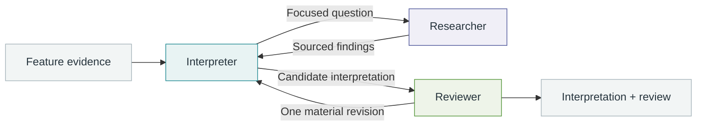

<div align="center">

# MGM2 SAE Agent

### From sparse activations to biological explanations

An evidence-driven, multi-agent workflow for interpreting microbial sparse autoencoder features.


[Overview](#overview) · [Workflow](#workflow) · [Quick start](#quick-start) · [Evidence](#evidence) · [Outputs](#outputs) · [Development](#development)

</div>

## Overview

What does a learned microbial feature represent: a lineage, an abundance pattern,
a community context, or a shared ecological relationship?

MGM2 SAE Agent connects feature activations to biological interpretation through
population statistics, taxonomic annotations, community comparisons, study
metadata, and targeted literature research. Built on [Pi](https://github.com/earendil-works/pi),
it brings these evidence sources into a coordinated interpretation and review
workflow, with a traceable record of the reasoning inputs and final claims.

- **Biology at multiple scales.** Examine individual OTUs, abundance distributions,
  surrounding communities, habitats, and variation across studies.
- **Research where it adds insight.** Use local evidence to describe activation
  patterns and consult the literature to resolve ecological or mechanistic questions.
- **Continuity across roles.** The interpreter develops the explanation, a researcher
  supplies focused findings, and a reviewer checks the resulting claims.
- **An inspectable result.** Each interpretation links back to evidence IDs and
  archived sources, accompanied by review, timing, and usage records.

## Workflow



**Interpreter.** Reads activation summaries and diagnostic comparisons, develops
the feature explanation, and owns the final report. Its session persists across
research and review handoffs.

**Researcher.** Answers a concrete biological question using public sources.
Research is activated when external knowledge is useful; statistical descriptions
can proceed directly to review. Retrieved passages are archived for reuse.

**Reviewer.** Independently checks numerical statements, evidence coverage,
biological reasoning, and source support. Material feedback returns to the same
interpreter for one revision, followed by another review.

The adaptive workflow uses two sessions for evidence-only explanations and adds
the researcher when needed. It supports two research requests per feature and
retains the final review verdict alongside the interpretation.

## Quick start

### 1. Install

Requires **Node.js 22.19+**. The project pins **Pi 1.4.0**.

```bash
git clone https://github.com/LudensZhang/mgm2-sae-agent.git
cd mgm2-sae-agent
npm ci --ignore-scripts
```

An existing Pi installation can also be selected with `SAE_PI_PACKAGE`:

```bash
export SAE_PI_PACKAGE=/path/to/node_modules/@earendil-works/pi-coding-agent
```

For literature retrieval, install or reuse **pi-web-access 0.45.0** and set its path:

```bash
export SAE_WEB_PACKAGE=/path/to/node_modules/pi-web-access
```

The default location is `~/.pi/agent/npm/node_modules/pi-web-access`. The agent
uses its MCP interface, Exa search, and PDF text extraction. Runtime resources
and scientific skills are scoped to this project.

### 2. Configure a model

| Model profile | Reasoning | Authentication | Service |
| --- | --- | --- | --- |
| `gpt-6.1-sol` | `high` | Pi OpenAI / Sign in with ChatGPT | `api.openai.com/v1` |
| `deepseek-flash` | `max` | `DEEPSEEK_API_KEY` or Pi DeepSeek credentials | `api.deepseek.com` |

GPT-6.1 Sol uses the existing Pi OAuth sign-in with the
`chatgpt.tokens.use.direct` scope and is billed against ChatGPT subscription usage.
The SDK manages credential refresh. Its proxy is configured through
`SAE_OPENAI_PROXY`, which defaults to `http://127.0.0.1:17897`.

DeepSeek uses the official Flash profile, identified in the configuration as
**DeepSeek-V4.1-Flash-1017**. Credentials are read from the environment or the
selected provider entry in `~/.pi/agent/auth.json`. Use `--auth-path` to select
another credential file.

The selected model and reasoning effort are checked against each serialized
request and recorded in the run artifacts.

### 3. Prepare the evidence

Run an offline preflight to normalize the packet, check its structure and
identifier policy, and write the evidence overview:

```bash
node src/cli.mjs \
  --workflow adaptive --model gpt-6.1-sol \
  --packet /path/to/feature/bundle.json \
  --out runs/feature-preflight
```

### 4. Interpret a feature

```bash
node src/cli.mjs \
  --workflow adaptive --model gpt-6.1-sol \
  --packet /path/to/feature/bundle.json \
  --out runs/feature-sol61 \
  --source-cache runs/shared-sources \
  --live --web
```

`--live` starts provider requests; `--web` enables literature retrieval.
Use a fresh output directory for each attempt. The optional source cache shares
original retrieved passages across runs, while each interpretation retains its
own evidence, source, and review records.

To run the same workflow with DeepSeek, select `--model deepseek-flash`.
The manifest records the model, reasoning, retrieval, timing, and output settings
used for each run.

## Evidence

Agents start with an overview and an evidence index, then retrieve the records
needed for their current question. Grouped reads make the exported summaries
available efficiently; individual records remain addressable by ID and JSON
Pointer.

| Evidence | Questions it helps answer |
| --- | --- |
| Activation census | How broadly does the feature activate across tokens, communities, and studies? |
| Taxonomy and habitat | Which lineages and environments contribute activations, and which are enriched? |
| Abundance profiles | Does activation track abundance, within-community rank, or a particular abundance range? |
| Community context | How do diversity, dominance, and composition differ around active tokens? |
| Within-OTU and matched comparisons | How does the same organism behave across community contexts? |
| Public study metadata | Does the signal track an ecological setting, a study, or an assay? |
| Retrieved literature | Which biological relationships help explain the observed pattern? |

Packets expose `core.facts`, selected cases, matched controls, and exported
`analysis_results`. Event-, community-, and study-level quantities retain their
respective denominators. Abundance labels are resolved from the packet's codebook,
and packet metadata records the scope and provenance of the evidence.

Verified public study accessions remain available for interpretation and source
lookup. Private identifier checks run locally before live execution.

### Source grounding

Research archives the exact text returned by retrieval, together with its URL,
timestamp, and content hash. The reviewer can inspect the cited passages directly
from the shared archive. Source IDs connect the final claims to these records,
making both the biological explanation and its supporting material easy to inspect.

## Outputs

Each run produces a self-contained result directory:

```text
runs/feature-sol61/
├── interpretation.json     # Feature name, explanation, and evidence-linked claims
├── audit.json              # Reviewer assessment and material issues
├── completion.json         # Final status, elapsed time, and aggregate usage
├── manifest.json           # Model settings, packet hash, and code hashes
├── packet.json             # Normalized evidence
├── overview.json           # Evidence index
├── sources/                # Archived source passages and provenance
├── interpret/              # Interpreter sessions and request records
├── research/               # Research sessions, when activated
└── review/                 # Reviewer sessions and request records
```

Start with `interpretation.json` and `audit.json`. The completion record reports
`complete`, `needs_review`, or `failed`, together with research requests and
revision counts. Session records expose the actual request model, reasoning
effort, tool activity, and phase-level usage.

Usage reports separate input, output, and cached-input tokens. Cost fields carry
Pi's model-catalog estimates; subscription quota is tracked through the provider's
account interface. Each attempt keeps its own result and usage history.

## Development

The project loads two domain-specific skills in full:

- [`sae-interpretation`](skills/sae-interpretation/SKILL.md): activation statistics,
  microbial taxonomy, community context, biological interpretation, and review.
- [`source-grounding`](skills/source-grounding/SKILL.md): research questions,
  source appraisal, evidence extraction, and claim-level support.

These skills adapt scientific critical-thinking and literature-review methods
from [K-Dense Scientific Agent Skills](https://github.com/K-Dense-AI/scientific-agent-skills)
to microbial representation analysis. See [design references](docs/REFERENCES.md)
and [adaptation attribution](docs/KDENSE_LICENSE.txt).

Run the offline regression suite:

```bash
node tests/core.test.mjs
node tests/adaptive.test.mjs
node tests/terminal_sdk.test.mjs
python tests/test_repair_packets.py
```

The tests cover packet normalization, evidence transport, abundance labels,
source access, role handoffs, review revisions, and terminal report submission.
SDK tests use synthetic responses and in-memory credentials.

<details>
<summary>Legacy workflow and comparison tools</summary>

The five-role workflow remains available through `--workflow legacy`:

```text
observe → literature → critic → synthesis → audit
```

Each role uses a separate Pi session with an explicit handoff. The CLI's
compatibility default is `legacy`; the quick-start commands explicitly select
`adaptive`. A separate `gpt-6-sol` / `high` profile supports historical comparisons.

`scripts/profile_runs.mjs` summarizes phase-level usage and tool activity.
`scripts/audit_literature_need.mjs` supports claim-level retrieval analysis.
`scripts/repair_packets.py` rebuilds evidence packets from cached statistics and
streamed event data. Experiment-specific pilot scripts retain their original
feature selections and run configurations.

</details>
