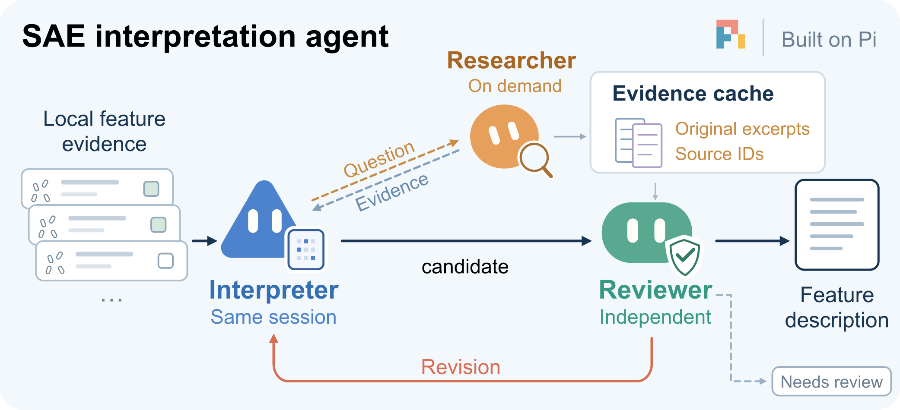

<div align="center">

# MGM2 SAE Agent

### From sparse activations to biological explanations

Interpret microbial features through local evidence, targeted research, and independent review.


[Overview](#overview) · [Workflow](#workflow) · [Getting started](#getting-started) · [Results](#results)

</div>

## Overview

MGM2 SAE Agent helps you understand what a sparse autoencoder feature captures
in microbial communities—from taxonomic preferences and abundance patterns to
habitat associations and ecological relationships.

Provide the evidence for a feature, and the agent develops a biological
interpretation, investigates relevant literature, and reviews the explanation
against the data. The result is a concise feature description with traceable
supporting evidence.

## Workflow



- **Interpret.** Identify the feature's activation pattern using taxonomy,
  abundance, community context, and study-level evidence.
- **Research.** Investigate biological questions as they arise and retain the
  original source excerpts for shared reference.
- **Review.** Check the explanation against the evidence and refine it through
  a revision when needed.

The interpreter keeps its context throughout the process. Literature research
is used where it adds biological insight, and the final description is delivered
together with the review.

## Getting started

### Install

Requires **Node.js 22.19+**, a configured model account in **Pi**, and
**pi-web-access** for literature retrieval. The project uses Pi 1.4.0 and
pi-web-access 0.45.0.

```bash
git clone https://github.com/LudensZhang/mgm2-sae-agent.git
cd mgm2-sae-agent
npm ci --ignore-scripts
```

### Provide a feature evidence packet

The input is a `bundle.json` file containing the feature's activation statistics
and biological context.

| Evidence | What it reveals |
| --- | --- |
| Activation statistics | How broadly the feature appears across OTUs, communities, and studies |
| Taxonomy and habitats | Which organisms and environments are associated with activation |
| Abundance and community profiles | How activation relates to abundance, diversity, and dominance |
| Matched comparisons | How the same organism behaves in different community contexts |
| Study metadata | Connections to sampling environments, cohorts, and experimental settings |

Packets organize summary statistics in `core.facts`, examples and controls in
`annex`, and additional analyses in `analysis_results`. The agent reads the
evidence relevant to each question and links its claims to the underlying records.

### Run an interpretation

```bash
node src/cli.mjs \
  --workflow adaptive --model gpt-6.1-sol \
  --packet /path/to/feature/bundle.json \
  --out runs/my-feature \
  --live --web
```

Choose a new output directory for each run. To check a packet before starting
an interpretation, run the same command with `--live --web` omitted.

| Model | Selection |
| --- | --- |
| GPT-6.1 Sol · high | `--model gpt-6.1-sol` |
| DeepSeek Flash · max | `--model deepseek-flash` |

To reuse retrieved literature across features, add
`--source-cache runs/shared-sources`.

## Results

Start with these files in your output directory:

| File | What you get |
| --- | --- |
| `interpretation.json` | A feature name, biological explanation, and evidence-linked claims |
| `audit.json` | The reviewer's assessment and any points requiring attention |
| `sources/` | Retrieved passages, source links, and citation records |
| `completion.json` | Run status, elapsed time, and token usage |

Each run also records its evidence and model settings, so you can revisit a
feature, compare explanations, or build a searchable feature catalogue.

The explanations connect observations across biological scales: **which taxa
activate, how their abundance and community context matter, and which ecological
relationships help explain the pattern**.

## Built with

[Pi](https://github.com/earendil-works/pi) provides the agent runtime. Two
project-specific scientific skills support
[feature interpretation](skills/sae-interpretation/SKILL.md) and
[source grounding](skills/source-grounding/SKILL.md), adapting methods from
[K-Dense Scientific Agent Skills](https://github.com/K-Dense-AI/scientific-agent-skills).

See the [design references](docs/REFERENCES.md) and
[adaptation attribution](docs/KDENSE_LICENSE.txt).
